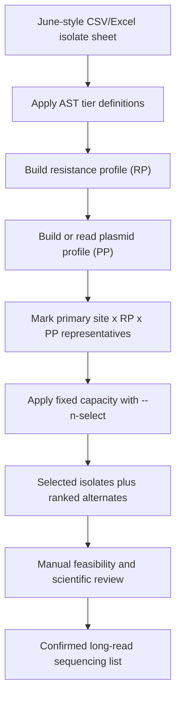

# Manager briefing: long-read isolate selection approach

## What this repository provides

This repository provides a reproducible method for choosing a fixed number of
short-read sequenced `Klebsiella pneumoniae` survey isolates for long-read
sequencing.

The method is designed for the GHRU plasmid-analysis objectives:

- capture carbapenemase and ESBL plasmid diversity;
- include convergent resistance/virulence strains where present;
- support investigation of possible plasmid transmission;
- avoid allowing one sentinel site, one resistance profile, or one repeated ST
  to dominate the sequencing set.

The repository contains:

- a written SOP;
- an input schema matching the June workbook style;
- a selection script that accepts CSV or Excel;
- a simulated example showing the complete process;
- a plasmid set-cover helper for checking rare plasmid coverage.

## Decision logic in plain language

The selection is deliberately hierarchical. The script does not treat all fields
as equal weights, because the scientific priority is not equal across all
fields.

| Decision level | What is prioritised | Why |
| --- | --- | --- |
| 1 | AST tier | Carbapenem non-susceptible isolates are the primary long-read target. |
| 2 | Primary site-profile coverage | Each sentinel site should contribute representative `RP x PP` combinations before duplicates are taken. |
| 3 | Sentinel-site balance | The selected set should not be dominated by one site with many candidates. |
| 4 | Plasmid profile | Distinct plasmid profiles are prioritised to support plasmid diversity analysis. |
| 5 | AMR/virulence flags | Convergent strains and carbapenemase/ESBL signals are retained where data are available. |
| 6 | ST | ST is used mainly to avoid unnecessary duplication after the higher-priority criteria have been applied. |
| 7 | Feasibility review | Culture/DNA availability and local sequencing route are checked before final confirmation. |

This means ST is not the primary driver. ST is useful, but it should not override
the main objective of resolving clinically important plasmids across sites.

## Workflow at a glance



## How a site or analyst applies it

1. Start with the June-style isolate sheet, either as Excel or CSV.
2. Ensure it includes at least isolate ID, sentinel site, AST tier or AST calls,
   resistance profile, and plasmid profile or plasmid replicons.
3. Choose the sequencing capacity, for example 48, 96, or 120 isolates.
4. Run:

```bash
python3 scripts/select_longread_samples.py \
  --input isolate_priority_longread_2026-05-22.xlsx \
  --n-select 96 \
  --output outputs/longread_selection_96.csv
```

5. Review rows with `selected_for_sequencing = yes`.
6. Check culture/DNA availability and replace failed isolates with ranked
   alternates.
7. Prepare the GHRU assembly samplesheet for confirmed isolates.

## What the output means

The output keeps every input isolate. It adds:

| Output column | Meaning |
| --- | --- |
| `priority_rank` | Overall ranked order in the full candidate table. |
| `selection_batch` | `Primary` if this isolate covers a site/profile combination before duplicates; `Secondary` otherwise. |
| `selected_for_sequencing` | `yes` for isolates inside the requested `--n-select` cutoff. |
| `selection_rank` | Order in which selected isolates should be processed. |
| `selection_reason` | Human-readable explanation showing tier, batch, site, plasmid profile, RP, and ST. |

The unselected rows are not discarded. They are ranked alternates.

## What still needs human approval

The script makes the priority list auditable, but final confirmation remains a
scientific and operational decision. The review group should confirm:

- the requested number of long-read isolates is feasible;
- selected isolates are available and have sufficient DNA/culture;
- any important outbreak or convergent strain has not been excluded;
- rare plasmid signals are covered or consciously excluded;
- each site has a route for sequencing and assembly.
